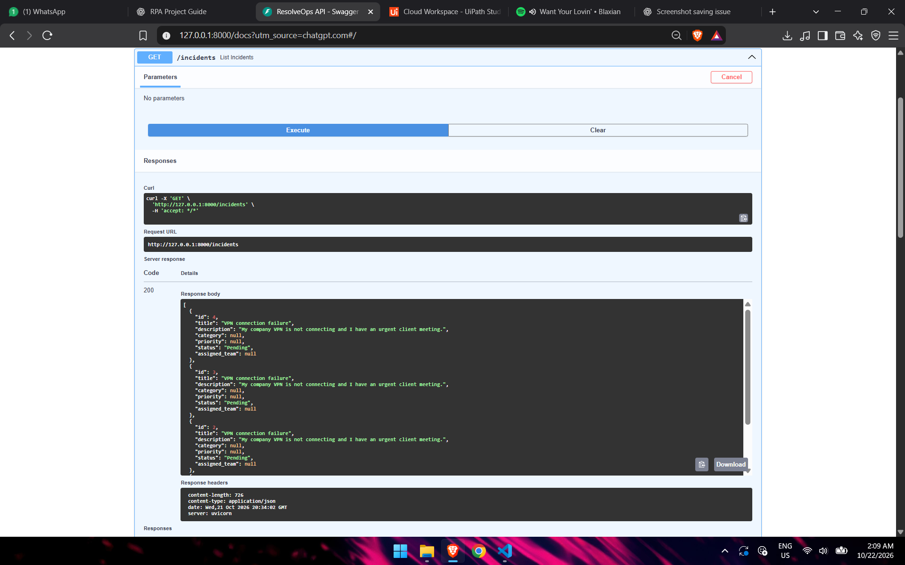
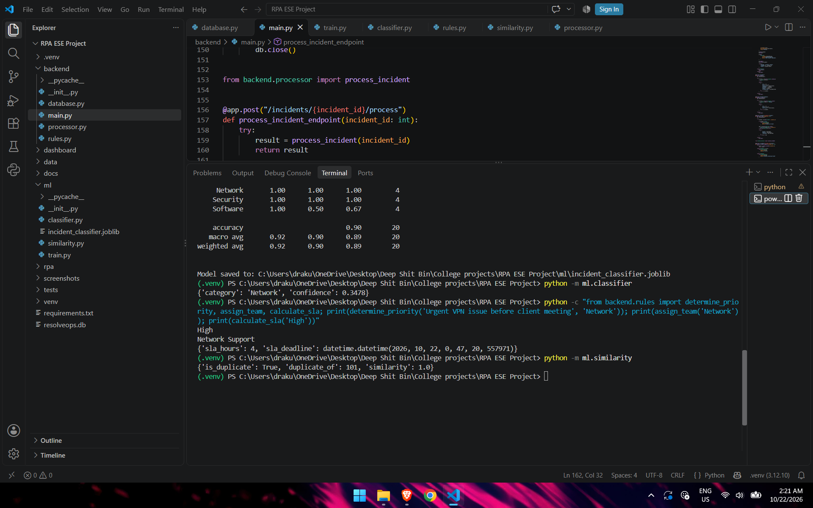
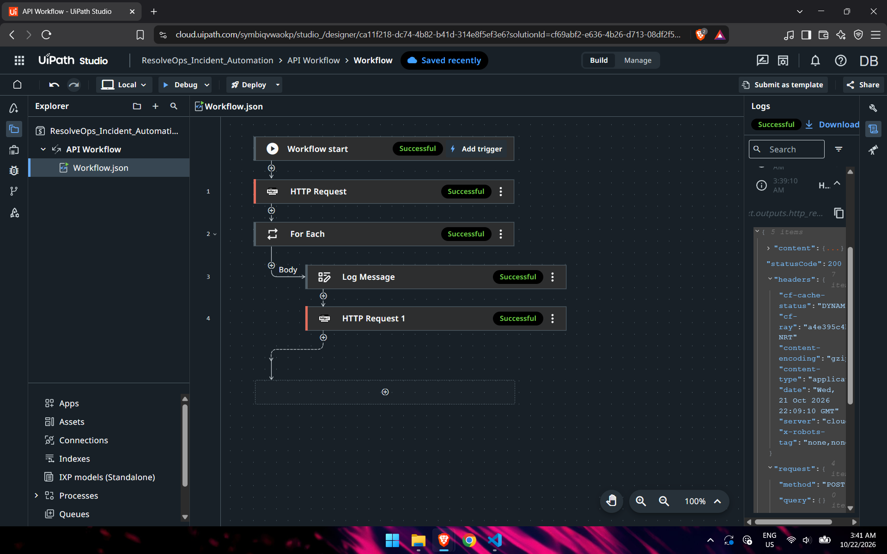
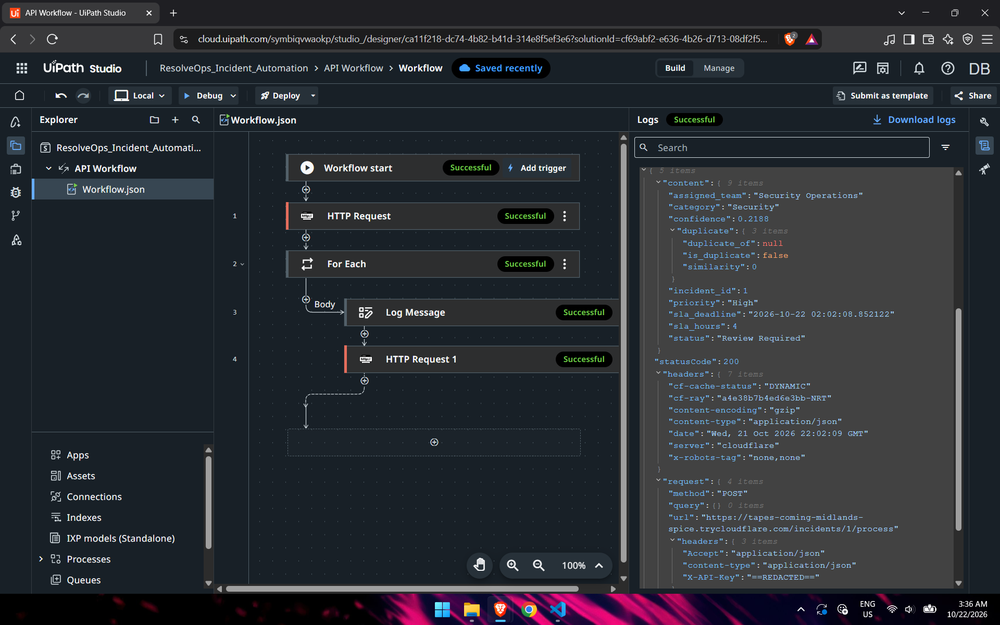
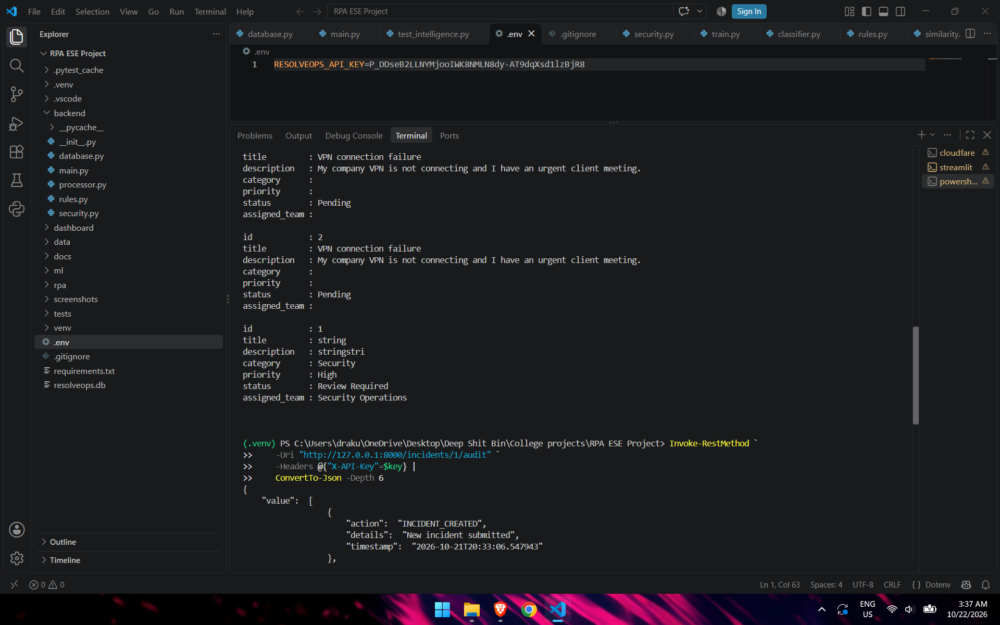
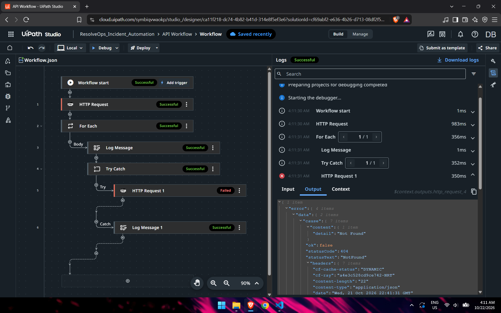
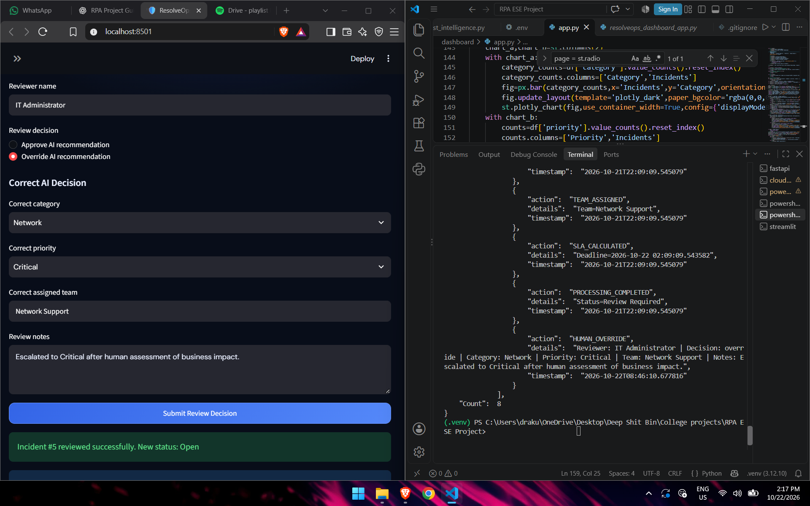

# ResolveOps — Intelligent IT Incident Automation

**An AI-assisted Robotic Process Automation (RPA) system for IT incident classification, routing, SLA monitoring, and human-in-the-loop decision-making.**

ResolveOps integrates UiPath Studio Web, Python FastAPI, machine learning, SQLite, and Streamlit to automate repetitive IT help-desk operations while maintaining traceability and human oversight.

## Project Overview

IT support teams frequently handle incidents manually. Incoming tickets must be reviewed, categorized, prioritized, assigned to the appropriate support team, and monitored against service-level agreements (SLAs).

ResolveOps automates this workflow using RPA orchestration and machine learning.

The system retrieves pending incidents, classifies them, assigns priorities and teams, calculates SLA deadlines, and records processing actions. Incidents requiring additional judgment are directed to a human-review queue.

## Key Features

- **UiPath RPA Integration:** Automatically retrieves and processes pending incidents through REST APIs.
- **Machine Learning Classification:** Uses TF-IDF and logistic regression to categorize IT support incidents.
- **Intelligent Routing:** Assigns priorities and responsible support teams.
- **Duplicate Detection:** Identifies potentially duplicate incidents.
- **Human-in-the-Loop Review:** Supports approval and overrides for uncertain classifications.
- **Dynamic SLA Management:** Calculates deadlines according to incident priority and recalculates them after priority overrides.
- **Automated SLA Monitoring:** Uses APScheduler for periodic SLA checks.
- **Notification Simulation:** Generates and processes notification records without requiring an external messaging provider.
- **Audit Logging:** Records important processing, review, and SLA events.
- **Streamlit Dashboard:** Provides incident visibility, analytics, human review, and SLA monitoring.
- **API Security:** Protects endpoints using API-key authentication.
- **Exception Handling:** Handles processing failures through UiPath Try Catch and backend validation.

## Technology Stack

| Component | Technology |
|---|---|
| RPA orchestration | UiPath Studio Web |
| Backend API | Python, FastAPI |
| Machine learning | scikit-learn, TF-IDF, Logistic Regression |
| Database | SQLite, SQLAlchemy |
| Dashboard | Streamlit |
| Scheduling | APScheduler |
| API integration | REST, JSON |
| Local-to-cloud connectivity | Cloudflare Quick Tunnel |
| Version control | Git, GitHub |

## System Architecture

```text
Incoming IT Incident
         |
         v
FastAPI Incident Creation
         |
         v
SQLite Database (Pending)
         |
         v
UiPath Studio Web
         |
         | GET /incidents/pending
         v
For Each Pending Incident
         |
         | POST /incidents/{id}/process
         v
FastAPI Processing Engine
         |
         +--> ML Classification
         +--> Duplicate Detection
         +--> Priority Assignment
         +--> Support Team Routing
         +--> Confidence Evaluation
         |
         +--> Automatic Processing
         |
         +--> Human Review (if required)
         |
         v
SLA Deadline Calculation
         |
         v
Database and Audit Logs
         |
         +--> Scheduled SLA Monitoring
         +--> Notification Simulation
         |
         v
Streamlit Dashboard
```

## Automation Workflow

1. An incident is created through the FastAPI backend.
2. The incident is stored with a Pending status.
3. UiPath retrieves pending incidents using an authenticated HTTP GET request.
4. UiPath iterates through the returned incidents.
5. For each incident, UiPath sends an authenticated HTTP POST request to the processing endpoint.
6. FastAPI performs ML classification, routing, and SLA calculation.
7. The incident and its audit records are saved to SQLite.
8. Streamlit displays the updated incident data.
9. APScheduler periodically checks SLA conditions and creates notification records when appropriate.
10. UiPath logs successful processing and handles processing errors using Try Catch.

## SLA Rules

| Priority | SLA Duration |
|---|---|
| Critical | 1 hour |
| High | 4 hours |
| Medium | 8 hours |
| Low | 24 hours |

SLA deadlines are recalculated when a human reviewer changes an incident's priority.

## Project Structure

```text
ResolveOps/
├── backend/
│   ├── main.py
│   ├── database.py
│   ├── processor.py
│   ├── rules.py
│   ├── security.py
│   ├── scheduler.py
│   ├── sla_monitor.py
│   └── notifier.py
├── dashboard/
│   ├── app.py
│   ├── monitoring.py
│   ├── review.py
│   └── resolveops_dashboard_app.py
├── ml/
│   ├── classifier.py
│   ├── similarity.py
│   ├── train.py
│   └── incident_classifier.joblib
├── data/
│   └── training_data.csv
├── tests/
│   └── test_intelligence.py
├── screenshots/
├── .env.example
├── .gitignore
└── requirements.txt
```

## Installation and Setup

### Prerequisites

- Python and pip
- Git
- UiPath Studio Web account (for RPA execution)
- Cloudflared (for cloud-to-local API connectivity)

### 1. Clone the repository

```powershell
git clone https://github.com/MrLoSt1805/ResolveOPs.git
cd ResolveOPs
```

### 2. Create a virtual environment

```powershell
python -m venv .venv
.\.venv\Scripts\Activate.ps1
```

### 3. Install dependencies

```powershell
python -m pip install -r requirements.txt
```

### 4. Configure the API key

Copy `.env.example` to `.env`:

```powershell
Copy-Item .env.example .env
```

Edit `.env` and replace the placeholder with your own secret API key.

Never commit `.env` to GitHub.

### 5. Start the FastAPI backend

```powershell
python -m uvicorn backend.main:app --reload
```

API address:

`http://127.0.0.1:8000`

Interactive API documentation:

`http://127.0.0.1:8000/docs`

### 6. Start the Streamlit dashboard

In a second terminal, activate the virtual environment and run:

```powershell
python -m streamlit run dashboard/app.py
```

Dashboard address:

`http://localhost:8501`

### 7. Connect UiPath Studio Web

Start a temporary HTTPS tunnel:

```powershell
cloudflared tunnel --url http://127.0.0.1:8000
```

Copy the generated HTTPS URL into the UiPath HTTP Request activities.

The UiPath workflow uses:

- `GET /incidents/pending`
- `POST /incidents/{id}/process`

Both requests require the `X-API-Key` header.

The tunnel URL is temporary and may change when restarted.

**Note:** The UiPath Studio Web workflow must be configured separately; its exported project is not currently included in this repository.

## API Endpoints

| Method | Endpoint | Description |
|---|---|---|
| POST | `/incidents` | Create an incident |
| GET | `/incidents` | Retrieve incidents |
| GET | `/incidents/pending` | Retrieve pending incidents |
| POST | `/incidents/{id}/process` | Process an incident |
| GET | `/incidents/{id}/audit` | Retrieve incident audit history |
| GET | `/incidents/review` | Retrieve human-review queue |
| POST | `/incidents/{id}/review` | Approve or override a decision |
| POST | `/sla/check` | Execute SLA monitoring |
| GET | `/scheduler/status` | Retrieve scheduler status |
| GET | `/notifications` | Retrieve notification records |
| POST | `/notifications/process` | Process pending notifications |

## Testing and Validation

The following scenarios have been demonstrated:

| Test scenario | Observed result |
|---|---|
| UiPath-to-FastAPI processing | HTTP 200 |
| Incident persistence | Verified in SQLite |
| ML classification | Network category assigned |
| Priority assignment | Medium priority assigned |
| Team routing | Network Support assigned |
| SLA calculation | Deadline persisted |
| Invalid incident state | HTTP 400 |
| Invalid API key | HTTP 401 |
| Human priority override | SLA recalculated |
| Notification processing | Simulated notification records |
| Scheduler operation | Scheduler running with one job |

### Verified End-to-End Example

A VPN connectivity incident was processed successfully:

```text
Incident ID: 13
Status: Open
Category: Network
Priority: Medium
Assigned Team: Network Support
SLA Deadline: 2026-10-23 03:15:53
```

UiPath returned HTTP 200, and the final incident values were verified in SQLite.

### Automated Tests

The repository includes a test module at:

`tests/test_intelligence.py`

The test suite can be inspected and extended to cover additional backend and integration scenarios.

## Project Screenshots

### API Documentation



### Machine Learning Classification



### UiPath Automation Workflow



### Successful UiPath Processing



### Database Verification



### Exception Handling



### Human Review and Override



## Security

- API endpoints require an API key.
- Secrets are loaded from environment variables.
- The `.env` file is excluded from version control.
- The local SQLite database is excluded from version control.
- Invalid API keys are rejected.

## Current Limitations

ResolveOps is an academic prototype rather than a production ITSM platform.

- Notifications are simulated rather than delivered through a live messaging provider.
- SQLite is used for local persistence.
- The Cloudflare Quick Tunnel URL is temporary.
- The classifier is trained on a limited example dataset.
- The UiPath Studio Web workflow must be configured separately until its export is added.

## Future Enhancements

- Real email or messaging notifications.
- Persistent cloud deployment.
- Expanded incident training data.
- Role-based access control.
- Advanced analytics and reporting.
- Integration with enterprise ticketing systems.
- More extensive automated integration testing.

## Conclusion

ResolveOps demonstrates how robotic process automation can be combined with machine learning, API-based integration, human oversight, SLA monitoring, and operational dashboards to improve IT incident handling.

The project showcases an end-to-end workflow connecting UiPath Studio Web with a Python-based intelligent processing system.
